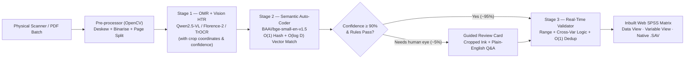

# MediExtract SPSS

**Automated clinical encounter form scanner, open-weight handwriting extractor, medical auto-coder, and inbuilt Web SPSS engine.**


> *Human-first healthcare digitization. Turn physical clinic paper stacks into validated, analysis-ready IBM SPSS (`.sav`) datasets in seconds—100% offline and private.*

---

## The problem and who it is for

**Users:** Non-technical clinic records clerks, Monitoring & Evaluation (M&E) supervisors, and biostatisticians at public health agencies and health insurance schemes (such as **OYSHIA** and **AHEAD Nigeria**).

Health agencies collect tens of thousands of handwritten patient encounter forms, clinic registers, and survey questionnaires every year. Getting those paper sheets into **IBM SPSS Statistics (`.sav`)** currently requires:
1. Manually typing 30+ columns per patient sheet.
2. Flipping through 178+ diagnosis codes and 241+ medication codes to translate doctor handwriting (e.g., *"HTN"*, *"High BP"*, *"Dyspepsia"*) into SPSS numeric codes (`2.0`, `98.0`).
3. Installing expensive IBM SPSS licenses just to inspect or validate records.
4. Discovering missing IDs, impossible ages, and clinical contradictions months after data collection.

## What MediExtract SPSS does

Place a stack of paper forms into the scanner (or drop a scanned PDF). MediExtract SPSS processes the batch through a **human-first 3-step workflow**, anchored to **cropped physical paper evidence**:

1. **Dual-Mode Scanner Ingestion** — Watches a local scanner "Hot Folder" (`C:\EncounterForms\ScanQueue`) to auto-ingest sheets the moment the physical scanner button is pressed, alongside manual drag-and-drop / file-path upload. Automatically deskews pages, enhances faint ink, and splits multi-page stacks.
2. **Open-Weight Handwriting & Medical Auto-Coding** — Reads checkboxes via deterministic Optical Mark Recognition (OMR) and transcribes doctor handwriting via open-weight vision models. A local semantic embedding index automatically maps written clinical notes to official SPSS codebook numbers (e.g., *"Hypertention"* $\rightarrow$ `2.0`, *"Amlodipine"* $\rightarrow$ `14.0`).
3. **Human-First Guided Verification Station** — Fields with $\ge 90\%$ confidence auto-save. Low-confidence handwriting is surfaced one question at a time alongside the **cropped image snippet of the doctor's ink** for 1-click confirmation.
4. **Inbuilt Dual-View Web SPSS Studio** — Virtualized spreadsheet supporting **Data View**, **Variable View**, live **`1 ↔ Words` Value Labels toggling**, cell-level paper provenance popovers, and **1-click native `.sav` binary export** via `pyreadstat`.
5. **Multi-Project & Analyst Validation Engine** — Create isolated project workspaces for any new form (by uploading an existing `.sav` template or a blank PDF questionnaire). Generates comprehensive **Data Analyst Validation Reports** (with custom filtering by Facility, LGA, Month, or Condition).
6. **Multi-Clerk SPSS Harmonizer & Master Merger** — Upload 30+ clerks' separate `.sav` files at once. Automatically aligns variable spelling/case drift, reconciles conflicting Value Label codebooks by meaning (so one clerk's `265 = Eczema` never overwrites another clerk's `265 = Asthma`), auto-heals string/numeric type mismatches, removes cross-file duplicates, and outputs one unified `MASTER.sav`.

## How the pipeline scales (Big $O$ architecture)



| System Operation | Naive Approach | MediExtract Approach | Complexity | Performance at 50,000 Cases |
| :--- | :--- | :--- | :--- | :--- |
| **Grid Rendering** | Render all cells ($O(N \cdot M)$) | Virtual DOM Windowing | **$O(K)$** ($K \approx 30$ rows) | **60 FPS, 0 ms lag** |
| **Duplicate Check** | Full table scan ($O(N)$) | Composite Key Hash Set | **$O(1)$** | **$< 0.001\text{ ms}$ per form** |
| **Medical Auto-Code** | Linear string scan ($O(D)$) | Inverted Hash + HNSW Vector | **$O(1)$ / $O(\log D)$** | **$\sim 1\text{ ms}$ across 400+ codes** |
| **Validation Audit** | Multi-pass loops ($O(P \cdot N)$) | Single-Pass Columnar C/NumPy | **$O(N)$** | **$< 0.05\text{ s}$ for 10,981 rows** |

## Open-weight models and licence compliance

| Role | Model | Where it runs | Licence | Notes |
| :--- | :--- | :--- | :--- | :--- |
| Document Vision & Form Layout (primary) | `Qwen/Qwen2.5-VL-7B-Instruct` (or `3B`) | Local Ollama / vLLM / HF | Apache-2.0 | Full-page handwriting + structure |
| Lightweight Vision & Phrase Grounding | `microsoft/Florence-2-large` | Local ONNX / PyTorch | MIT | Fast bounding-box & OCR on CPU/GPU |
| Isolated Handwritten Line OCR | `microsoft/trocr-base-handwritten` | Local ONNX / Transformers | MIT | Specialized ink recognition |
| Clinical Codebook Semantic Matcher | `BAAI/bge-small-en-v1.5` | Local (FastEmbed / ONNX) | MIT | 33M params, 384-d cosine matching |
| Schema & Validation Report Writer | `meta-llama/Llama-3.2-3B-Instruct` | Local Ollama | Llama 3.2 Community | Built with Llama |

**100% Local Privacy (NDPA / HIPAA Safe):** Patient names, phone numbers, and medical diagnoses never leave the agency's local machine. No proprietary cloud APIs are called with patient records. Details: [`docs/shared/03-open-weight-models.md`](docs/shared/03-open-weight-models.md).

## Monorepo layout

```
medi-extract-spss/
├── AGENTS.md              # rules every coding agent reads first
├── DESIGN.md              # HCI & design system specification (owner: Peace)
├── MASTER_PROMPTS.md      # bootstrap prompts for D1–D5 and P1–P5
├── LICENSE                # MIT
├── backend/               # FastAPI + pyreadstat + OCR + validation engine (owner: DuroT)
├── frontend/              # Human-first Web UI + Virtualized SPSS Studio   (owner: Peace)
├── fixtures/              # anonymized sample schemas & mock presets       (owner: DuroT)
└── docs/
    ├── PRD.md             # Complete Product Requirements Document for stakeholders
    ├── shared/            # architecture, API contracts, open-weight model specs
    ├── duro/  peace/      # per-developer execution playbooks (D1–D5 & P1–P5)
    ├── requests.md        # cross-module contract change log
    └── AI_ASSISTANCE.md   # AI-assistance disclosure log
```

## Reproducible local setup

Prerequisites: Python 3.12+ (or [`uv`](https://docs.astral.sh/uv/)), Node.js 20+, and optional local [Ollama](https://ollama.com) for offline vision inference.

```powershell
git clone https://github.com/Peaceyy28/medi-extract-spss.git
cd medi-extract-spss

# 1) Backend (using uv)
cd backend
uv run --python 3.12 uvicorn app.main:app --reload --port 8000

# 2) Frontend (new terminal)
cd frontend
npm install
npm run dev
```

> **Current Status:** Milestone 0 (Architecture, PRD & Repo Setup) complete. Currently in **Milestone 1 (UI/UX Research & Design System Finalization)** before scaffolding runtime code.

## Limitations (honest)

- Severely torn, water-damaged, or completely illegible scrawls cannot be guessed; the system flags them (`confidence < 80%`) for mandatory human confirmation.
- Physical scanners must support saving to a local/network folder or standard Windows WIA/TWAIN drivers.
- Exported `.sav` files follow IBM SPSS binary specifications via `pyreadstat` (ReadStat C library).

## Team

| Name | Role | GitHub |
| :--- | :--- | :--- |
| Durotoluwa Taiwo (DuroT) | Backend, Open-Weight OCR & SPSS Engine (`D1–D5`) | [@taiwodurotoluwa-svg](https://github.com/taiwodurotoluwa-svg) |
| Oluwanifemi Ojewusi (Peace) | Product Architect, HCI/UX Design & Frontend (`P1–P5`) | [@Peaceyy28](https://github.com/Peaceyy28) |

## Licences and acknowledgements

- Source code: **MIT** (see [`LICENSE`](LICENSE)).
- Libraries: FastAPI, Pydantic, `pyreadstat` (ReadStat), OpenCV, FastEmbed, Pandas/NumPy.
- No real patient identifiable information (PII) or live `.sav` clinical files are committed to this repository (enforced via `.gitignore`).
