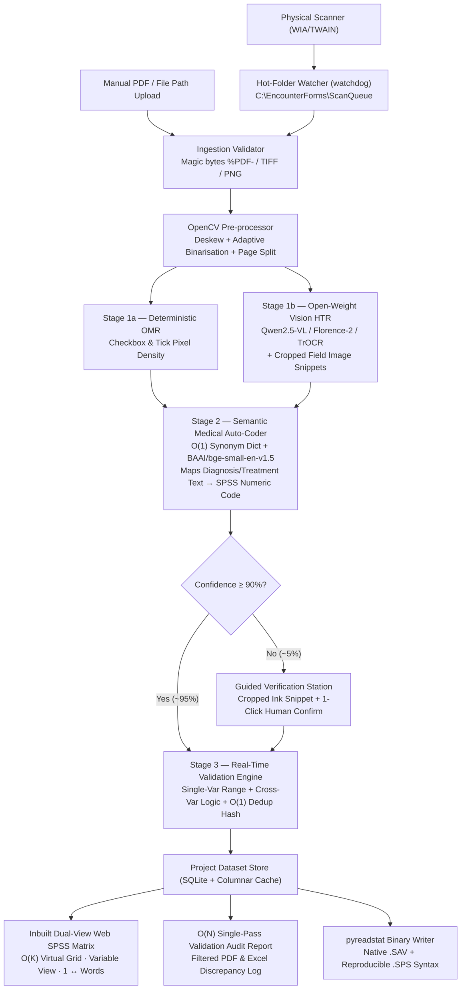

# 01 — System Architecture

End-to-end technical design of **MediExtract SPSS**: dual-mode scanner ingestion, pre-processing, open-weight vision & OMR extraction, semantic medical auto-coding, real-time validation engine, virtualized Web SPSS matrix, and native `.sav` binary generation.

## 1. End-to-End Dataflow

---

## 2. Dual-Mode Ingestion Layer

### 2.1 Hot-Folder Watcher (`watchdog`)
- Monitors a configurable local or LAN directory (default `C:\EncounterForms\ScanQueue`).
- Waits for file write completion (size stability across 500 ms) before moving the file into the active project's processing queue.
- Supports multi-page batch PDFs (e.g., 50 encounter forms scanned in one feeder pass) and splits pages into individual encounter cases.

### 2.2 OpenCV Pre-Processing
- **Deskewing:** Computes minimum-area bounding box angle via Hough transform / contour orientation and rotates the page to $0^\circ$ alignment.
- **Contrast Binarisation:** Applies CLAHE (Contrast Limited Adaptive Histogram Equalization) to sharpen faint blue or black ballpoint ink against off-white paper.
- **Field Bounding-Box Cropping:** Slices each field region into a lightweight WebP/PNG snippet (`crops/{batch_id}/{case_id}_{var_name}.webp`) for permanent audit provenance.

---

## 3. Hybrid Extraction & Medical Auto-Coding

### 3.1 Optical Mark Recognition (OMR)
- For categorical checkboxes (`Sex`, `Employer`, `Referral`), computes normalized ink fill ratio inside template anchor coordinates.

### 3.2 Handwritten Text Recognition (HTR)
- Uses open-weight vision-language models (`Qwen2.5-VL` or `Florence-2` + `TrOCR`) to read handwritten strings (`Name`, `FacilityPHC`, `Age`, `OYSHIA_ID`, `Diagnosis1..7`, `Investigation1..7`, `Treatment1..7`).
- Outputs structured JSON alongside token log-probability confidence scores ($0.0\text{–}1.0$).

### 3.3 Semantic Medical Auto-Coder ($O(1)$ + $O(\log D)$)
- **Tier 1 ($O(1)$ Hash Map):** Normalized lowercase/abbreviation lookup (e.g., `"htn"` $\rightarrow$ `2.0`, `"pud"` $\rightarrow$ `22.0`, `"mp"` $\rightarrow$ `73.0`).
- **Tier 2 ($O(\log D)$ Vector Match):** Embeds raw doctor text with `BAAI/bge-small-en-v1.5` (384-d) and computes cosine similarity against pre-embedded SPSS codebook value labels (178 diagnoses, 46 investigations, 241 treatments, 33 LGAs).

---

## 4. Real-Time Validation & Big $O$ Guarantees

1. **Single-Variable Rules ($O(1)$ per field):**
   - Numeric bounds (e.g., `0 <= Age <= 115`).
   - Codebook membership check (`val in meta.variable_value_labels[var]`).
   - Mandatory non-missing check (`OYSHIA_ID`, `Name`, `Diagnosis1`).
2. **Cross-Variable Clinical Logic ($O(1)$ per row):**
   - Evaluates boolean rules (e.g., `Sex == 1 AND Diagnosis IN [43, 44, 116, 117, 121, 224]` $\rightarrow$ Flag `RULE_CONTRADICTION`).
3. **Deduplication ($O(1)$ Hash Set):**
   - Maintains an in-memory & indexed hash set of `sha256(f"{OYSHIA_ID}_{Year}_{Month}_{FacilityPHC}")`.
4. **Analyst Audit Report ($O(N)$ Single-Pass):**
   - Computes variable completeness, age summary statistics, Whipple/Myers digit preference index (detecting age heaping on multiples of 5/10), top morbidities, polypharmacy averages, and per-facility clean rates in a single vectorized pass.
